<div align="center">

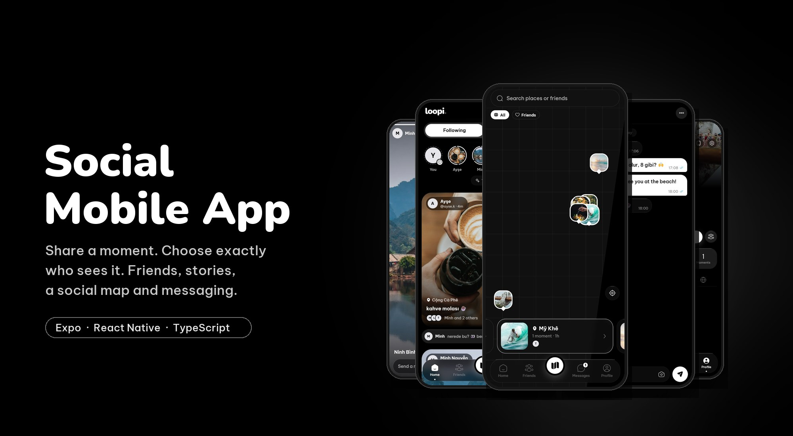

# Social Mobile App

**A photo-first social app for friends. Share a moment, choose exactly who sees it, and follow your
people through a feed, stories, a social map and messaging.**


**[Live demo →](https://kadrxy.github.io/social-mobile-app/)** <sub>(web build, best in your browser's phone view; use “Continue with Apple → Go to home” to skip sign-in)</sub>

</div>

> [!NOTE]
> **Frontend only.** The app runs on an in-memory mock backend with demo data, so it works offline and
> resets on restart. All data goes through one `Repository` interface, so a real backend can replace
> the mock without touching any screen. The UI shows the working brand name *loopi*.

## Contents

- [Screenshots](#screenshots)
- [Features](#features)
- [How it works](#how-it-works)
- [Getting started](#getting-started)
- [Project structure](#project-structure)
- [Testing](#testing)
- [Roadmap](#roadmap)
- [Credits](#credits) · [License](#license)

## Screenshots

| Sign in | Following | Discover | Story |
| :---: | :---: | :---: | :---: |
| 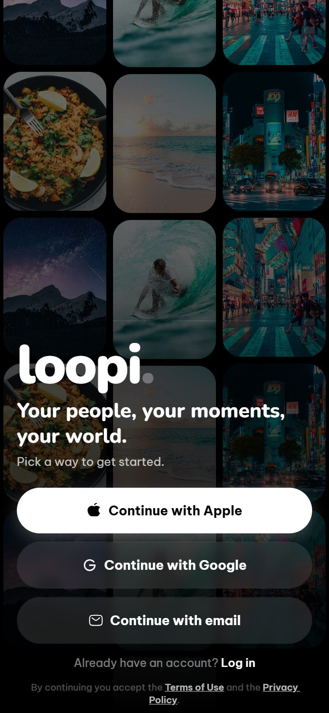 | 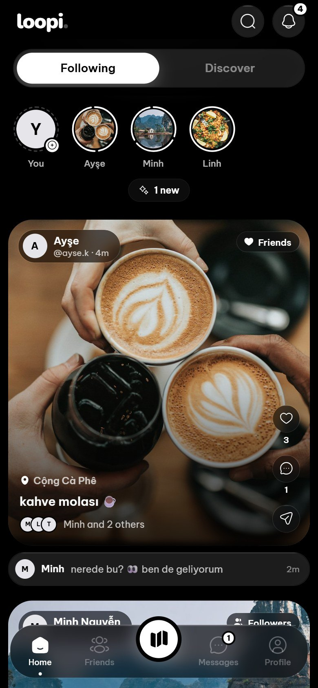 | 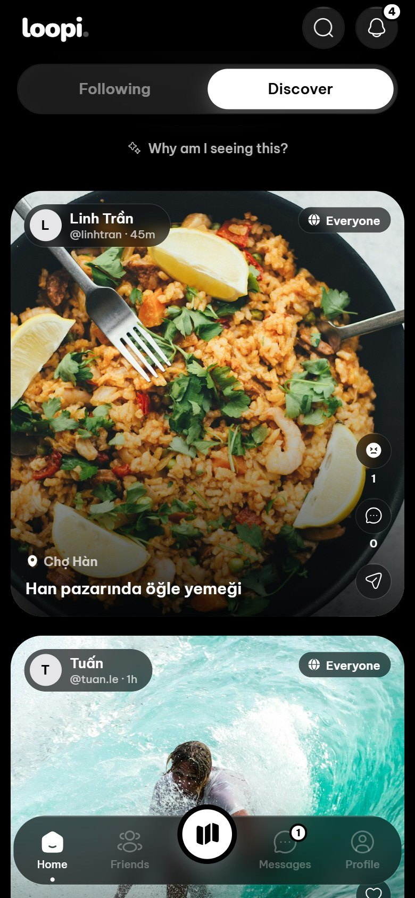 | 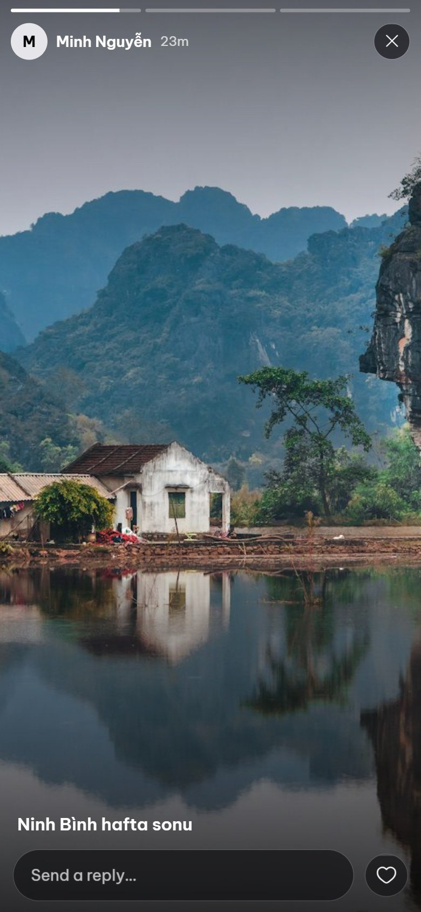 |
| **Comments** | **Social map** | **Share with location** | **Pick a place** |
| 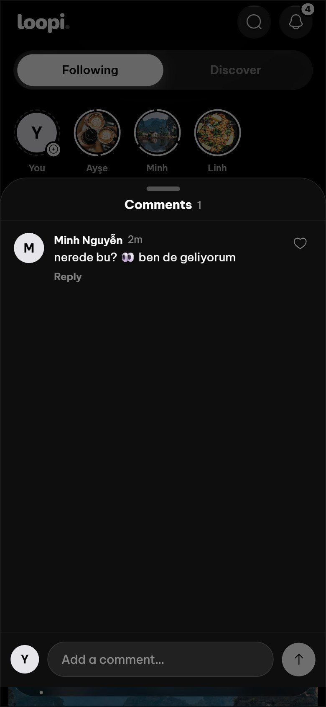 | 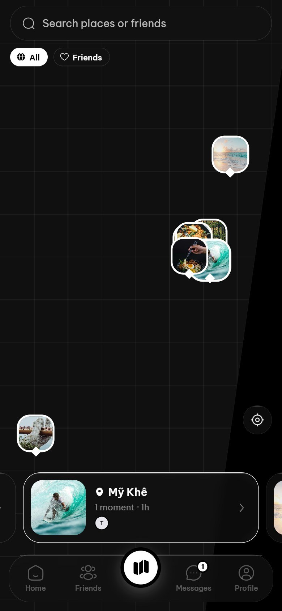 | 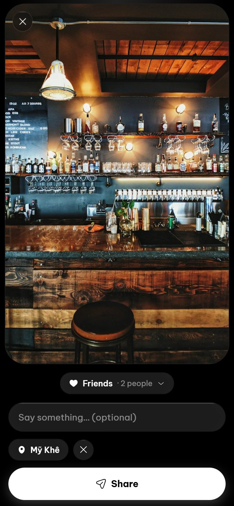 | 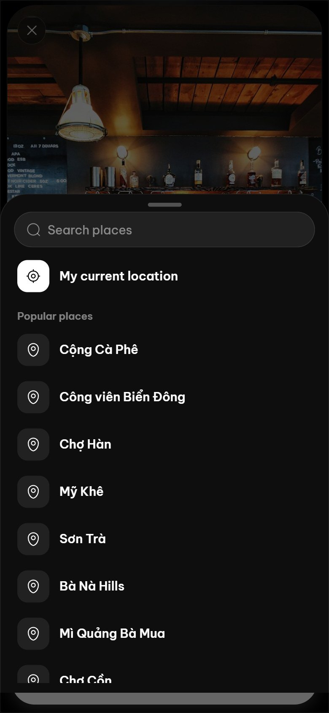 |
| **Messages** | **Chat with read receipts** | **Profile peek** | **Profile** |
| 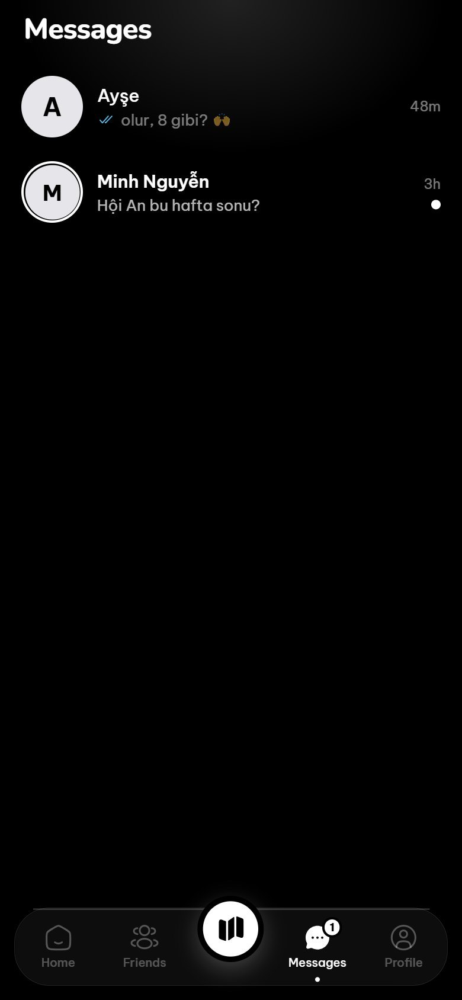 | 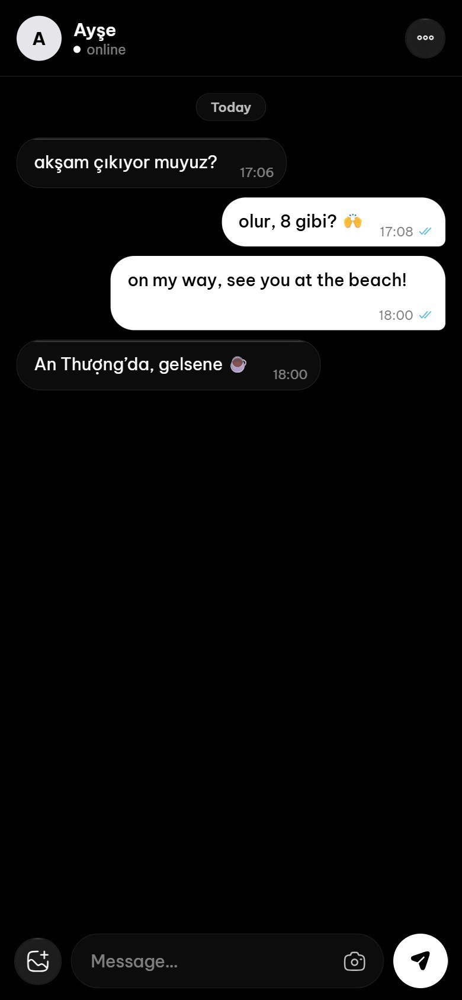 | 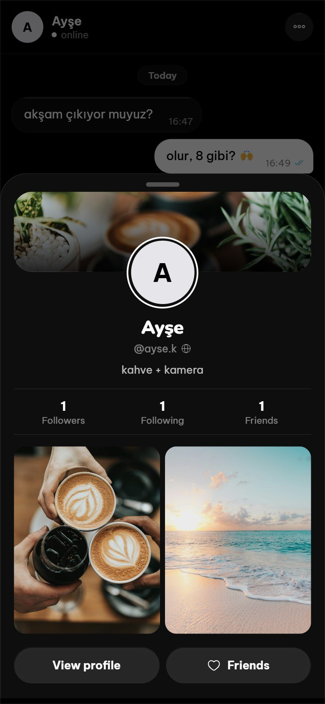 | 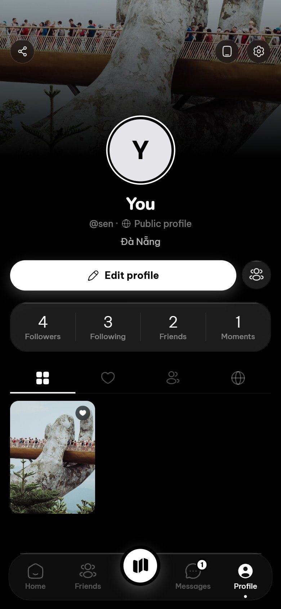 |
| **Notifications** | **Settings** | | |
| 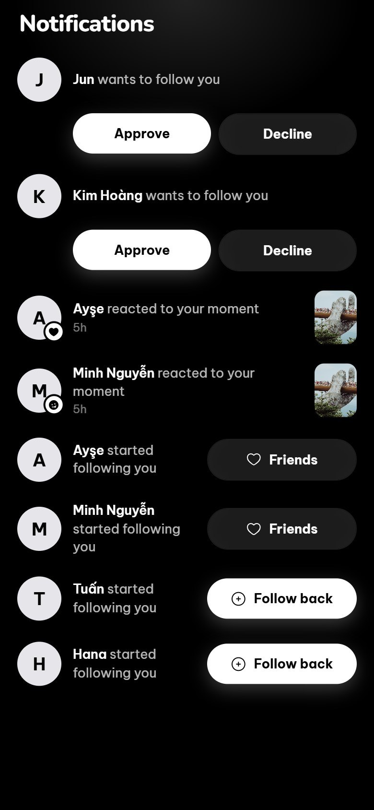 | 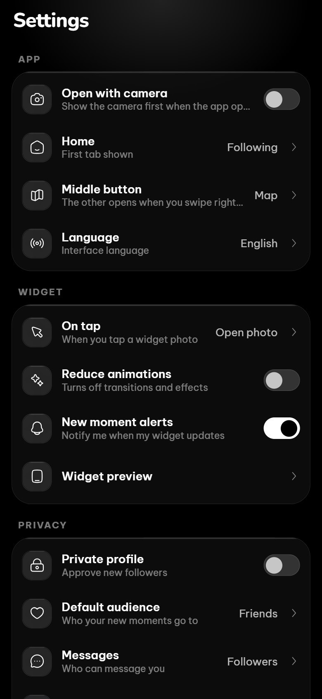 | | |

<sub>Captured from the web build at phone size (390×844). On a phone the map is a real dark map.</sub>

## Features

### Moments
- Take a photo or pick one from the gallery, add a caption and **tag a place** (your current location,
  asked for only when you tap it, or popular and already-used spots).
- Choose the **audience per moment**: friends (mutual follows), followers or everyone.

### Home
- **Following** and **Discover** pages that follow your finger, with a sliding pill.
- A **side page** one swipe right: the camera, or the map if you moved the camera to the middle tab.
- Stories row, "new moments" pill, pull to refresh with a brand loader.
- Instagram-style cards: **double-tap to like** with an icon fountain, long-press the heart for other
  reactions, comments and "send to" open as sheets without leaving the feed.
- Scrolling down slides the Following/Discover row away; tapping the Home tab again jumps to the top.

### Stories
- Opens as a **circle growing from the tapped ring**, **cube transition** between people.
- **Pull down to dismiss**: the story follows your finger, shrinks and closes as a circle (or springs
  back). Tap to step, hold to pause, reply or like at the bottom.

### Social map
- Moments as **photo pins per place**, a swipeable card strip, friends/all filter, search.

### Messages
- **Read receipts**: one tick sent, two ticks delivered, two blue ticks read, time in every bubble.
- Typing indicator, photo messages and photo replies, unread badges.
- Tap a person for a **profile peek** (bio, counts, latest moments, follow) instead of leaving the chat.

### People and safety
- Follow requests (approve or decline), notifications, accent-insensitive search.
- **Two-way blocking** and reports; blocked people disappear from every surface.
- Private profiles and **16-17 age protections** built into the rules.

### Account
- Profile editing (photo, cover, name, username, about), settings, privacy policy and terms in the
  app, **account deletion**, Turkish and English.

## How it works

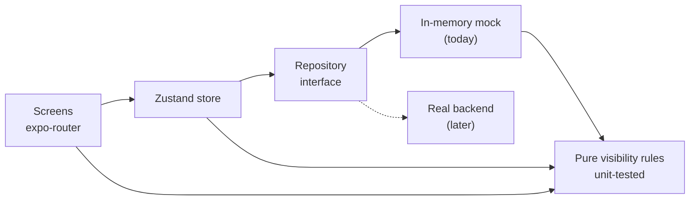

1. **Screens** read from the store with narrow selectors and call store actions.
2. The **store** calls the **repository**, which is asynchronous and event-driven (new messages and
   read receipts arrive through subscriptions), exactly like a network backend would be.
3. **Who can see or message whom** is decided by pure functions in `src/domain/rules.ts`, so the same
   rules can later be enforced on the server.

| Audience picked by the author | Stranger | Follower | Friend (mutual) | Blocked |
| --- | :---: | :---: | :---: | :---: |
| Everyone (public profiles only) | ✓ | ✓ | ✓ | – |
| Followers | – | ✓ | ✓ | – |
| Friends | – | – | ✓ | – |

Animations run on the UI thread with Reanimated: shared values follow your finger and drive several
elements at once (for example the Home pager moves the pill, the header and the tab bar together).

**The full explanation, with diagrams of the layers, data flow, rules, navigation and the story
transitions, is in [docs/ARCHITECTURE.md](docs/ARCHITECTURE.md).**

## Getting started

Requires **Node.js 22+**.

```bash
git clone https://github.com/kadrxy/social-mobile-app.git
cd social-mobile-app
npm install
npx expo start
```

- **Phone**: scan the QR code with [Expo Go](https://expo.dev/go) (iOS or Android).
- **Browser**: press `w` for the web preview (use your browser's phone view).
- **No setup**: try the [live web demo](https://kadrxy.github.io/social-mobile-app/).
- **Signing in**: there is no backend, so any email works and **any 6-digit code** is accepted (it
  continues on its own). "Continue with Apple" also offers a temporary **Go to home** shortcut.

| Command | What it does |
| --- | --- |
| `npm test` | Unit and component tests |
| `npm run typecheck` | TypeScript check |
| `npm run lint` | ESLint |
| `node scripts/build-icons.mjs` | Regenerates `src/ui/icon-data.ts` from the Solar icon set |

## Project structure

```
src/
├── app/                 Screens, one file per route (expo-router)
│   ├── (tabs)/          home · friends · center (map/camera) · inbox · profile
│   ├── story/[id].tsx   Story viewer (circle open, cube, pull to dismiss)
│   ├── post/[id].tsx    A person's posts as cards
│   ├── chat/[id].tsx    Conversation with read receipts
│   └── …                auth, search, notifications, settings, legal, delete-account
├── domain/              Types + pure visibility rules (unit-tested)
├── data/                Repository interface, in-memory mock, Zustand store, demo seed
├── features/            Camera, map, moment card, comments, send sheet, profile, legal texts
├── i18n/                Turkish and English strings
└── ui/                  Design system: Glass, Icon, Segmented, SwipePager, BottomSheet, loaders
scripts/                 Icon generator
docs/                    Architecture notes and screenshots
```

## Testing

```bash
npm test
```

62 tests cover the visibility rules (friends, private profiles, two-way blocking, minor locks, age from
birth date), search, notifications, the mock repository and store (follow requests, read receipts,
unread counts, comment likes, account deletion, persistence across restarts) and UI components.

## Roadmap

- [ ] Real backend (authentication, database, photo storage, realtime messaging, server-side rules)
- [ ] Push notifications
- [ ] Native home-screen widget (iOS and Android)
- [ ] Invite codes
- [ ] Place pages with reviews
- [ ] App icon and splash screen

## Credits

- Icons: **Solar** by 480 Design, [CC BY 4.0](https://creativecommons.org/licenses/by/4.0/), bundled
  via [`@iconify-json/solar`](https://www.npmjs.com/package/@iconify-json/solar)
- Sample photos in `assets/photos`: [Unsplash](https://unsplash.com) (Unsplash License)
- Fonts: Be Vietnam Pro, Nunito and Playfair Display (SIL Open Font License) via `@expo-google-fonts`
- Apple and Google sign-in marks (paths from Phosphor Icons, MIT) are trademarks of their owners

## License

The code is released under the [MIT License](LICENSE). Bundled third-party assets keep their own
licenses listed above.
