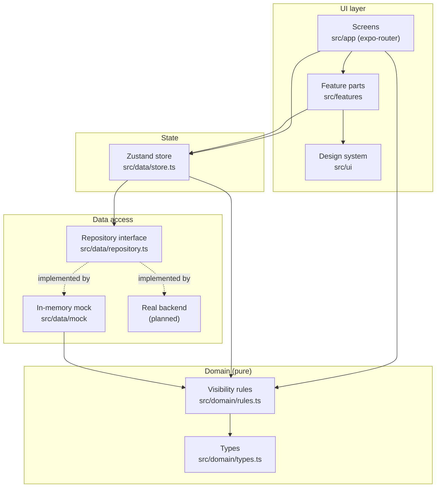
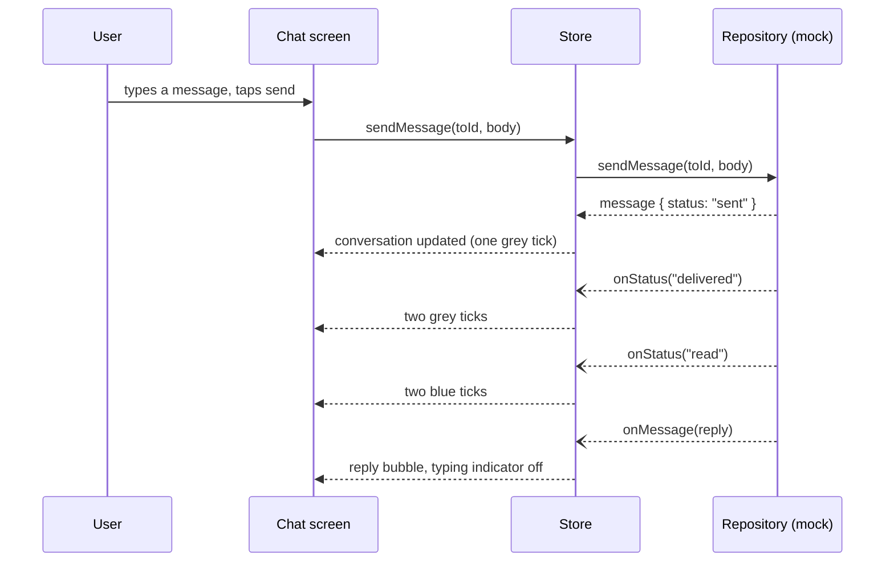
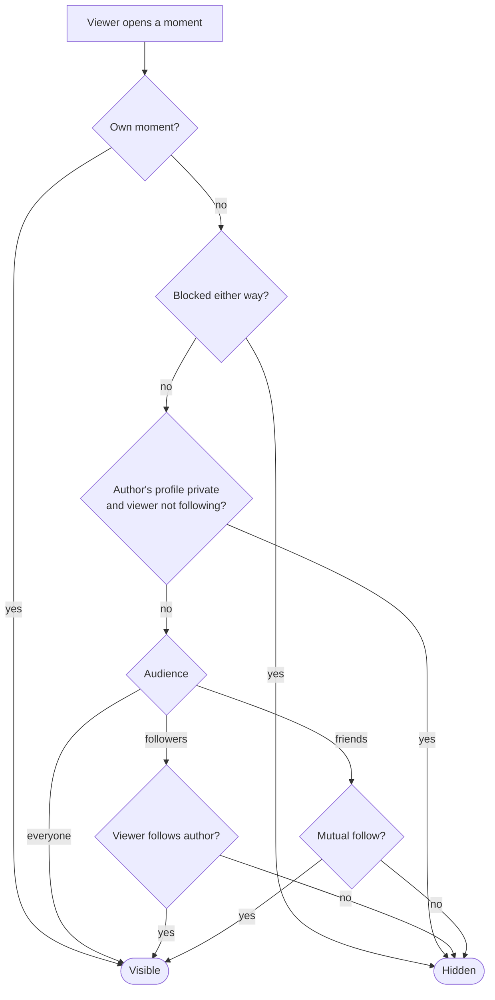
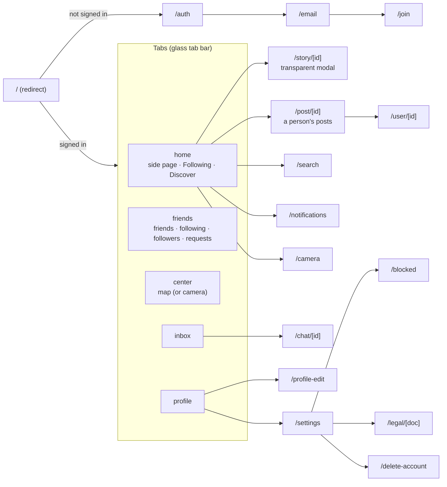

# How it works

This document explains how the app is put together: the layers, how data flows, the privacy rules,
navigation and the UI system. Everything described here is frontend; the backend is a mock that
implements the same interface a real server will.

- [1. Layers](#1-layers)
- [2. Data flow](#2-data-flow)
- [3. Privacy and visibility rules](#3-privacy-and-visibility-rules)
- [4. Navigation](#4-navigation)
- [5. Screens worth knowing](#5-screens-worth-knowing)
- [6. UI system](#6-ui-system)
- [7. State and persistence](#7-state-and-persistence)
- [8. Internationalisation](#8-internationalisation)
- [9. Testing](#9-testing)
- [10. Plugging in a real backend](#10-plugging-in-a-real-backend)

---

## 1. Layers

| Layer | Responsibility | Depends on |
| --- | --- | --- |
| `src/domain` | Types and **pure functions** that decide who can see or message whom. No React, no I/O. | nothing |
| `src/data` | The `Repository` interface, the in-memory mock, and the Zustand store that screens read from. | domain |
| `src/ui` | Design system: glass surfaces, icons, buttons, sheets, pagers, loaders. Never imports `src/data`. | nothing app-specific |
| `src/features` | Larger screen parts shared by routes (camera, map, moment card, comments, profile). | ui, data, domain |
| `src/app` | Screens. One file per route (file-based routing). | everything above |

The rules live in the domain layer so the **same code** can run on the client (to render) and, later,
on the server (to enforce): the UI never decides visibility on its own.

## 2. Data flow

Screens never talk to the backend directly. They call store actions; the store calls the repository
and puts the result in state; components re-render through narrow selectors (`useApp(s => s.x)`).

The repository is asynchronous on purpose, even in the mock, so every screen already handles the
latency it will see with a network. Realtime events (incoming messages, read receipts) arrive through
subscriptions: `onMessage(listener)` and `onStatus(listener)`, which return an unsubscribe function.

## 3. Privacy and visibility rules

All of these are pure functions in `src/domain/rules.ts`, covered by unit tests.

**Relations**

- **Follow**: one-way. Following a private profile creates a *pending* request until it is approved.
- **Friend**: mutual follow (both follow each other, both active).
- **Block**: works both ways. Either person blocking the other makes them invisible to each other.

**Who can see a moment** (`canView`)

| Audience picked by the author | Stranger | Follower | Friend (mutual) | Blocked |
| --- | :---: | :---: | :---: | :---: |
| Everyone (public profiles only) | ✓ | ✓ | ✓ | – |
| Followers | – | ✓ | ✓ | – |
| Friends | – | – | ✓ | – |

**Other rules**

- A private profile can never publish to "everyone"; the store narrows a stale picker to followers.
- **16-17 year olds**: their moments never enter Discover, their accounts default to private, and
  messaging between a minor and an adult who are not friends is blocked in both directions
  (`minorLockBlocks`). Age is computed from the full birth date (`ageOn`), not the year.
- **Messaging** (`canMessage`): each person chooses who may message them (everyone, followers,
  friends, nobody); blocks and the minor lock always win.
- **Discover** shows public moments from people you do not follow yet; **Following** shows what the
  rules allow from people you follow, newest first.
- **Search** folds accents and case (`Nguyễn` matches `nguyen`, `Ayşe` matches `ayse`) and never returns
  blocked people.
- **Notifications** (`activityFor`): reactions and comments on your moments, new followers and follow
  requests, never from blocked people.

## 4. Navigation

- Every pushed screen can be closed by **swiping from anywhere** on the screen; there are no back
  arrows. The swipe uses the same slide as the push (no fake shadow strip).
- Tapping the tab you are already on scrolls that screen back to the top (`src/ui/tabReselect.ts`).
- The middle tab is the **map** by default; Settings can switch it to the **camera**. Whichever is not
  in the middle becomes Home's side page, one swipe right from Following.

## 5. Screens worth knowing

**Home pager.** Home is a horizontal pager with three pages: *side page* (camera or map), *Following*,
*Discover*. One shared animation value (`homeProgress`, created with `makeMutable` in
`src/ui/immersive.ts`) follows the finger and drives three things at once on the UI thread: the white
pill in the header, the header sliding away, and the tab bar sliding down when the side page comes in.
Scrolling a list down slides the Following/Discover row up under the logo bar.

**Stories.** `/story/[id]` is a transparent modal that draws its own transitions:

- *Open*: a circle grows from the tapped ring. Its radius is animated, and the content inside is
  offset by the same amount so the photo stays still while the circle reveals it. The animation starts
  only once the first photo is drawn, so it is never spent behind the modal's presentation.
- *Between people*: each person is a cube face, rotated around the edge it shares with its neighbour
  (`perspective → translate to edge → rotateY → translate back`).
- *Close*: pull down and the story follows the finger, shrinking and rounding its corners while the
  screen below shows through; far or fast enough closes it as a circle into the centre, otherwise it
  springs back.
- 5 seconds per moment, tap left/right to step, hold to pause, reply and like at the bottom.

**Moment cards.** Like Instagram, a single tap does nothing and a double tap likes (big heart and an
icon fountain). The comment icon opens a draggable comments sheet in place; the send icon opens a
"send to" sheet that sends the moment as a DM; long-pressing the heart picks another reaction.

**Social map.** Moments with a place are grouped per place and shown as photo pins
(react-native-maps on phones, dark map style; a projected stand-in on web) with a swipeable card strip.

## 6. UI system

| Piece | Where | Notes |
| --- | --- | --- |
| Glass surfaces | `ui/Glass.tsx` | `expo-blur` with a translucent fill; monochrome black & white |
| Icons | `ui/Icon.tsx`, `ui/icon-data.ts` | Solar icons generated by `scripts/build-icons.mjs` into a typed map, rendered with `SvgXml`; line by default, bold when selected; no emoji anywhere in the UI |
| Segmented pill | `ui/Segmented.tsx` | Can be driven by a pager's progress; dark labels inside the pill slide the other way so text never disappears mid-swipe |
| Swipe pager | `ui/SwipePager.tsx` | Horizontal, finger-following pages; `autoHeight` mode for pagers inside a vertical scroll (profile grid) |
| Bottom sheet | `ui/BottomSheet.tsx` | Spring in, drag the grabber to close, keyboard aware |
| Pull to refresh | `ui/pull.tsx` | On iOS a brand loader appears in the gap and content is held down while refreshing; Android/web use the system spinner |
| Loader | `ui/LoopLoader.tsx` | Breathing tile inside a spinning dashed ring |
| Fountain | `ui/Burst.tsx` | Icons spray up on reactions and double-taps |

**Motion policy.** Animations run on the UI thread with Reanimated and are short (≈200–600 ms). They
play even when the phone has *Reduce Motion* on, because skipping every transition looked like a bug;
the in-app setting *Reduce animations* turns them off (`ReducedMotionConfig` in `src/app/_layout.tsx`).

**Fonts.** Be Vietnam Pro (UI), Nunito Black (display and wordmark), Playfair Display (accents).

## 7. State and persistence

The store (`src/data/store.ts`) holds the graph (users, follows, blocks), moments, conversations,
typing flags, story "seen" state and settings. A small slice survives restarts through an injected
key-value storage (AsyncStorage in the app, memory in tests): whether you are signed in, your settings
and your profile fields. Demo content itself resets on restart, because the mock is in memory.

Story rings are ordered by who you had seen at the last refresh, so a ring turns grey as soon as you
watch it but does not jump to the end under your finger.

## 8. Internationalisation

Turkish and English (`src/i18n/tr.ts`, `en.ts`) share one typed key set; a test fails if a key exists
in one language and not the other. The language follows the phone on first launch and can be changed
in Settings.

## 9. Testing

`npm test` runs Jest with jest-expo and Testing Library:

- **Domain rules**: visibility, friends, two-way blocking, minor locks, age from birth date, search
  folding, notifications, map grouping, a person's posts.
- **Data**: the mock repository and the store (follow requests, receipts sent → delivered → read,
  unread counts, comment likes, account deletion, persistence across restarts).
- **Components**: reaction bar (icons, no emoji), controls, empty states, translation key parity.

Reanimated is replaced by a small mock in `jest.setup.js`; animations resolve to their final value.

## 10. Plugging in a real backend

Write a class or factory that implements `Repository` and pass it to `createAppStore` in
`src/data/index.ts`. Nothing else changes.

| Method | Purpose |
| --- | --- |
| `getGraph()` | Users, follows and blocks |
| `updateMe(patch)` | Edit my profile and privacy fields |
| `listMoments()` / `createMoment(input)` | Read and post moments (with audience and place) |
| `react(id, reaction)` / `comment(id, body)` / `toggleCommentLike(id, commentId)` | Interactions |
| `toggleFollow(userId)` / `respondFollow(fromId, accept)` | Follows and requests |
| `toggleBlock(userId)` | Block or unblock (also ends follows) |
| `listConversations()` / `sendMessage(toId, body, replyTo?, image?)` / `markRead(withId)` | Messaging |
| `onMessage(listener)` / `onStatus(listener)` | Realtime subscriptions |
| `deleteAccount()` | Permanently remove my account |

The visibility rules should also be enforced on the server (for example with row-level security), so a
modified client can never see more than the rules allow.
